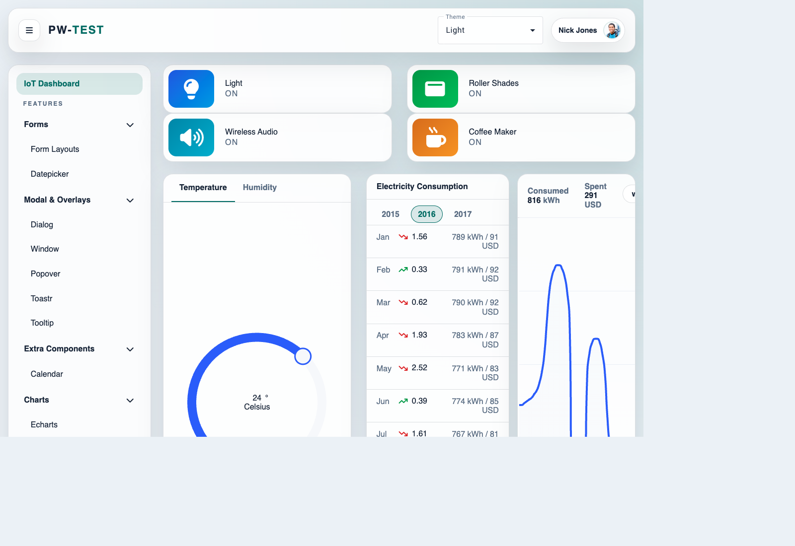
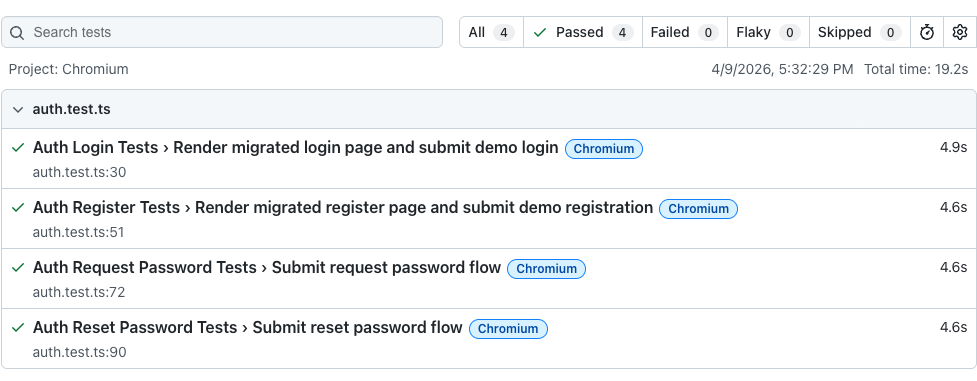

# Playwright Playground

[](https://github.com/tryb3l/playwright-playground/actions/workflows/playwright.yml)


End-to-end Playwright test suite ([`e2e/`](e2e/)) for an Angular 21 dashboard ([`app/`](app/)). Both live in this repository so the full setup runs locally without external services.

<p align="center">
  
  
</p>

## Quick Start

```bash
npm install
npm install --prefix app
npx playwright install --with-deps
npm run test:e2e
```

Other commands:

```bash
npm start --prefix app        # Start the Angular app manually on http://localhost:4200
npm run test:e2e:debug        # Run Playwright in interactive debug mode
npm run test:e2e:parallel     # Run with 4 workers
npm run typecheck             # Run TypeScript check (tsc --noEmit)
npx playwright show-report    # Open the latest HTML report
```

`npm run test:e2e` frees port `4200`, runs `tsc --noEmit`, and runs Playwright. Playwright starts the Angular server automatically unless `REUSE_EXISTING_SERVER=true` is set.

## How the Suite Is Built

### 1. Screen-scoped test fixtures (`createTestForStartPage`)

[`e2e/lib/fixtures/custom-test.ts`](e2e/lib/fixtures/custom-test.ts) maps each `StartPage` entry to its page class. Before each test, the `startPageReady` auto-fixture opens `/`, clicks through the sidebar menu via [`NavigationComponent`](e2e/lib/components/navbar/navigation.component.ts), and injects the typed `pageObject`:

```ts
import { createTestForStartPage, expect, StartPage } from '@fixtures/custom-test';

const test = createTestForStartPage(StartPage.DatePicker);

test('Select date from common datepicker', async ({ pageObject }) => {
  const expectedDate = await pageObject.selectCommonDateFromToday(3);
  await expect(pageObject.getCommonDateInput()).toHaveValue(expectedDate);
});
```

### 2. Shared base fixtures and authentication

[`e2e/lib/fixtures/base-fixtures.ts`](e2e/lib/fixtures/base-fixtures.ts) extends `@playwright/test` with:

- **`authenticated`**: when `test.use({ authenticated: true })` is set, logs in through [`AuthPage`](e2e/pages/auth.page.ts) and saves storage state to `playwright/.auth/user.json`. Set `REUSE_AUTH=true` to reuse that file across runs.
- **`user`**: resolves credentials via [`e2e/lib/factories/users.ts`](e2e/lib/factories/users.ts) (generated per run, fixed default via `USE_DEFAULT_USER=true`, or loaded from JSON via `USE_USER_FROM_FILE=true` and `USER_CREDENTIALS_FILE=/path/to/file.json`).

### 3. Page objects and composite components

- **Page objects ([`e2e/pages/`](e2e/pages/))** own screen-level selectors, actions, and state readers so specs assert on locators or state objects rather than raw selectors.
- **Composite components ([`e2e/lib/components/`](e2e/lib/components/))** wrap multi-step widgets built on [`BaseComponent`](e2e/lib/components/base.component.ts): [`DatePickerComponent`](e2e/lib/components/date-picker/date-picker.component.ts), [`OptionListComponent`](e2e/lib/components/list/option-list.component.ts), [`HeaderComponent`](e2e/lib/components/navbar/header.component.ts), [`NavigationComponent`](e2e/lib/components/navbar/navigation.component.ts), [`FormComponent`](e2e/lib/components/forms/base/base.form.component.ts), [`InlineFormComponent`](e2e/lib/components/forms/inline-form.component.ts), and [`GridFormComponent`](e2e/lib/components/forms/grid-form.component.ts).

### 4. Console and network observability

[`e2e/lib/utils/observability-report.ts`](e2e/lib/utils/observability-report.ts), [`ConsoleErrorsTracker`](e2e/lib/utils/console-errors-tracker.ts), and [`NetworkErrorsTracker`](e2e/lib/utils/network-errors-tracker.ts) capture `console.error`, uncaught `pageerror`, failed requests, and HTTP `>= 400` responses during each test:

- Any captured noise is attached to the test result as an `Observability Errors` text report.
- Per-test options (`failOnConsoleErrors`, `failOnNetworkErrors`, `ignoreConsoleErrors`, `ignoreNetworkErrors`, `statusCodesToIgnore`, `strictNetwork`) control whether captured errors fail a passing test.
- If a test already failed on a primary assertion, the report is attached without masking the original error (tested in [`e2e/tests/observability-contract.test.ts`](e2e/tests/observability-contract.test.ts)).

### 5. Config and server lifecycle

[`playwright.config.ts`](playwright.config.ts), [`e2e/lib/utils/config-utils.ts`](e2e/lib/utils/config-utils.ts), and [`e2e/lib/utils/app-server.ts`](e2e/lib/utils/app-server.ts) load `.env.dev` (overridable via `ENV_FILE` and `BASE_URL`), configure Chromium and Firefox projects with `retain-on-failure` traces and failure screenshots, and manage the Angular server process group (`SIGTERM` with a 5-second grace timeout before `SIGKILL`).

## Test Specs

All 15 specs live in [`e2e/tests/`](e2e/tests/):

| Area | Specs |
|---|---|
| Authentication & Users | [`auth.test.ts`](e2e/tests/auth.test.ts), [`authenticated-fixture.test.ts`](e2e/tests/authenticated-fixture.test.ts), [`users.factory.test.ts`](e2e/tests/users.factory.test.ts) |
| IoT Dashboard | [`dashboard.test.ts`](e2e/tests/dashboard.test.ts) |
| Theme Switcher | [`theme-switcher.test.ts`](e2e/tests/theme-switcher.test.ts) |
| Forms & Calendars | [`form-layouts.test.ts`](e2e/tests/form-layouts.test.ts), [`datepicker.test.ts`](e2e/tests/datepicker.test.ts), [`calendar.test.ts`](e2e/tests/calendar.test.ts) |
| Modals & Overlays | [`dialog.test.ts`](e2e/tests/dialog.test.ts), [`window.test.ts`](e2e/tests/window.test.ts), [`toastr.test.ts`](e2e/tests/toastr.test.ts) |
| Tables & Charts | [`smart-table.test.ts`](e2e/tests/smart-table.test.ts), [`tree-grid.test.ts`](e2e/tests/tree-grid.test.ts), [`echarts.test.ts`](e2e/tests/echarts.test.ts) |
| Observability Contract | [`observability-contract.test.ts`](e2e/tests/observability-contract.test.ts) |

## Repository Structure

```text
app/                         Angular 21 application under test
docs/
  e2e/REQUIREMENTS.md        E2E project requirements
e2e/
  contracts/observability/   Contract test harness and custom reporter
  lib/
    components/              Composite UI widgets (datepicker, forms, navbar, option-list)
    factories/               Test user credential generation and file loading
    fixtures/                Base fixtures and createTestForStartPage registry
    utils/                   Config, app-server lifecycle, logger, console/network trackers
  pages/                     Screen-level page objects
  tests/                     End-to-end and contract test specs
GLOSSARY.md                  Domain terminology for the E2E suite
global-setup.ts              Global server readiness and process-group teardown hook
playwright.config.ts         Root Playwright configuration
```

## CI

[`.github/workflows/playwright.yml`](.github/workflows/playwright.yml) runs on pushes and pull requests to `main` and `master` using Node 26 (`npm ci`, `npx playwright install --with-deps`, `node --run test:e2e`) and uploads `playwright-report/` as an artifact for 30 days.

## License

MIT — see [`LICENSE`](LICENSE).


